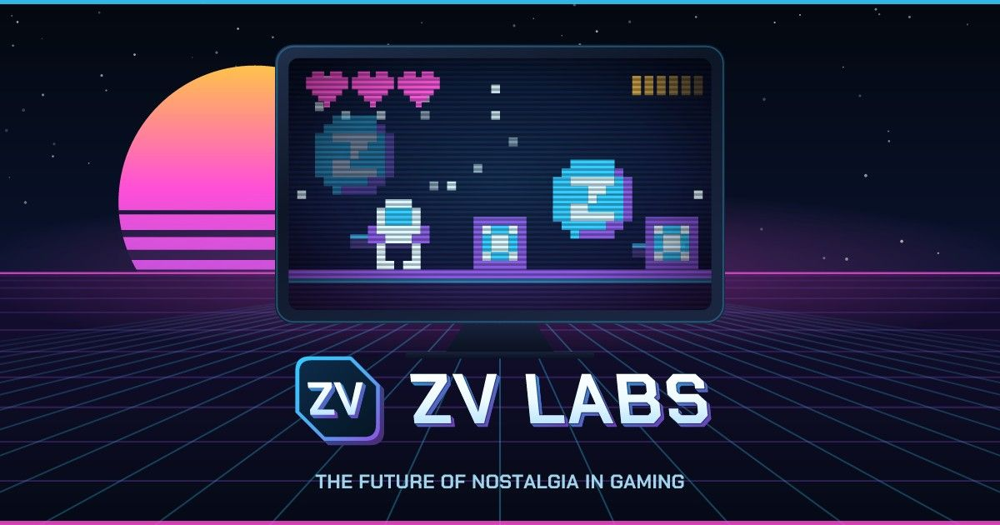
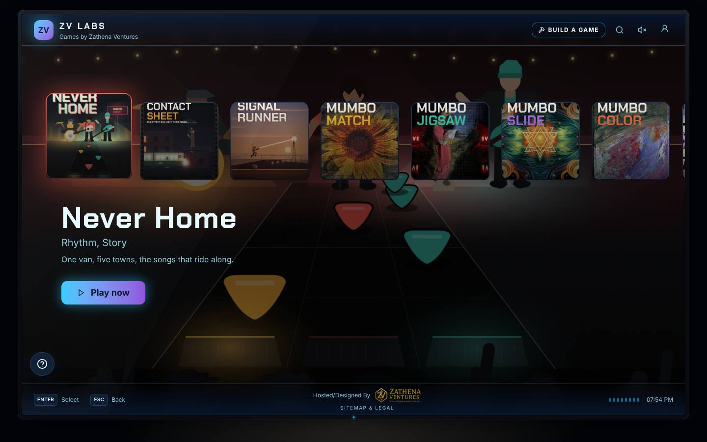
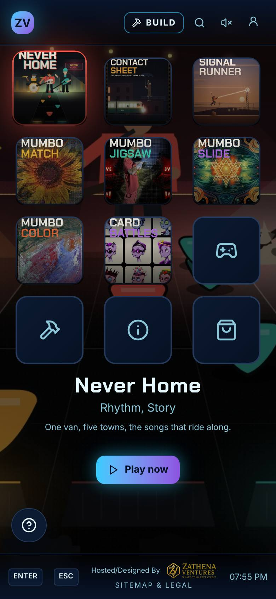

  

<h1 align="center"><a href="https://zvlabs.xyz">ZV Labs</a></h1>

  ZV Labs makes games: the future of nostalgia in gaming. The site feels like switching on a console from the era that raised us: it powers on, drops you onto a dashboard, and every page lives inside the machine. Play browser games in place, download the bigger ones, or bring a brief and have a game built to order.

  <strong>Live site:</strong> <a href="https://zvlabs.xyz">zvlabs.xyz</a>

  <a href="#what-it-is">What it is</a> · <a href="#services">Services</a> · <a href="#features">Features</a> · <a href="#book-or-get-in-touch">Get in touch</a> · <a href="#connected-brands">Connected brands</a>

  
  
  

<table>
  <tr>
    <td align="center" valign="top"> Desktop: the console dashboard.</td>
    <td align="center" valign="top"> Mobile: the same dashboard, driven by touch.</td>
  </tr>
</table>

## What it is

ZV Labs is the games brand of the Zathena Ventures family. It split out of the studio and now stands as its own brand, with its own [games library](https://zvlabs.xyz/games) and its own [build service](https://zvlabs.xyz/build) for clients.

The site is the arcade and the shop window. Browser games run full screen inside the console with nothing to install. Bigger games come as downloads for your own machine, with the size and a checksum on the page. The library includes games made with brands the studio works with, such as the Mumbo puzzles and the Raver Realm card battles.

## Services

- **[Games built to order](https://zvlabs.xyz/build)**: ZV Labs builds games for clients, from a brief to a launch page. The Build page explains how it runs.

## Features

### The console
- **A real start-up**: a power-on screen, then the Zathena Ventures family of brands landing one by one. The full version plays once; after that it takes a few seconds, and any key, click or controller button skips it.
- **A console dashboard**: browse the site like a game menu, with the arrow keys, a mouse or a touch screen.
- **Search from anywhere**: from the top bar, or Ctrl+K (Cmd+K on a Mac).

### Playing
- **[Games that open in place](https://zvlabs.xyz/games)**: browser games run full screen inside the console, and a controller works the way it does on a real one.
- **Downloads for bigger games**: install on your own machine, with the size and checksum shown up front.

### Built for everyone
- **Accessibility from one button**: text size, dyslexia-friendly reading, high contrast, colour-vision filters, reduced motion and read-aloud.
- **An honest [accessibility statement](https://zvlabs.xyz/accessibility)** that says plainly what does not work yet.
- **Nothing collected**: no analytics, no cookies, no third-party scripts. Sign-in is optional and by emailed link.

## Book or get in touch

Have a game in mind? Start on the [Build page](https://zvlabs.xyz/build), or [book a free consult](https://zathenaventures.xyz/contact?book=consult) with Zathena Ventures.

## Connected brands

- **[Zathena Ventures](https://zathenaventures.xyz)**: the studio and central hub that ZV Labs came from ([repo](https://github.com/ZATHENA-VENTURES/ZathenaVentures-Public)).
- **[ZV Media](https://zvmedia.xyz)**: film, video, photography and sound.
- **[The Zathena Gallery](https://app.zathenaventures.xyz)**: the walkable 3D Zathena world, with a wing for ZV Labs.
- **[Mumbo Vibes](https://mumbotopia.com)** and **[Raver Realm](https://raverrealm.xyz)**: client brands with games in the ZV Labs library, both built and hosted by Zathena Ventures.

## License

© 2026 ZV Labs. All rights reserved.

## Credits & Contact

- **Live site:** [zvlabs.xyz](https://zvlabs.xyz)
- **Designed, built and hosted by:** [Zathena Ventures](https://zathenaventures.xyz)

> This is the public showcase of a private repository. It presents the project, its features and its live site, and leaves out source code and deployment details.
